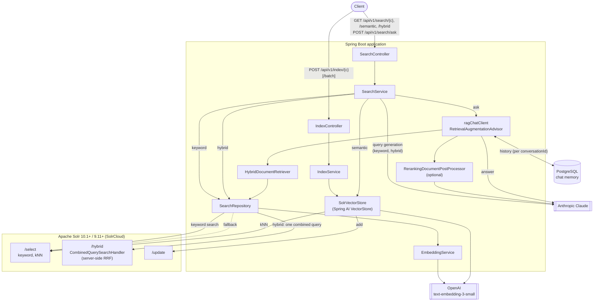
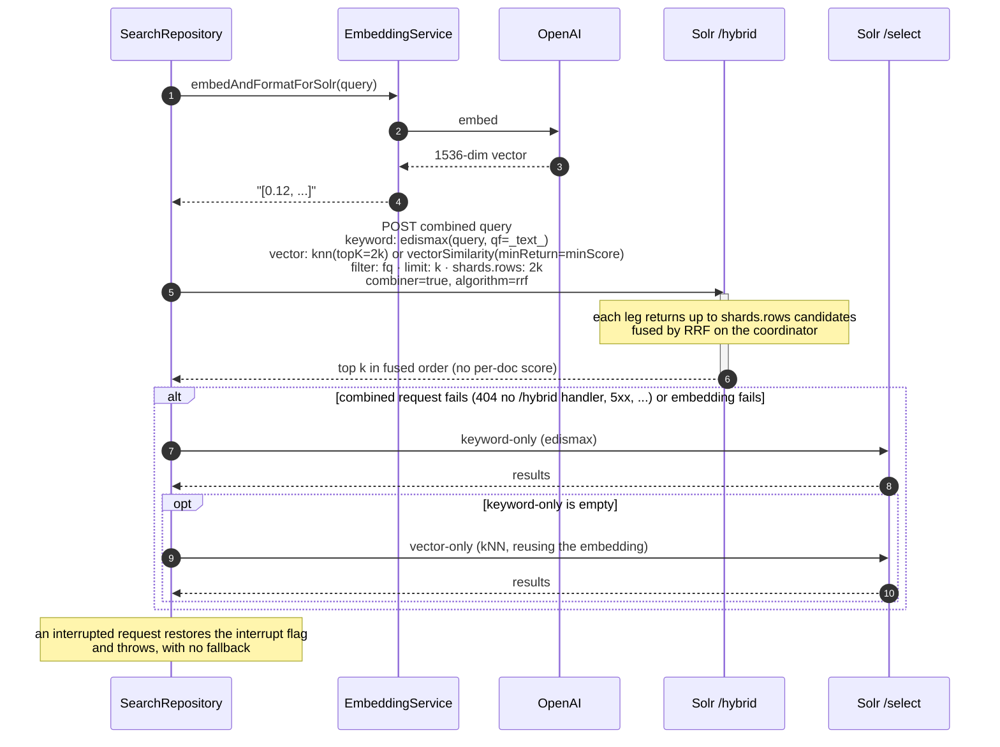
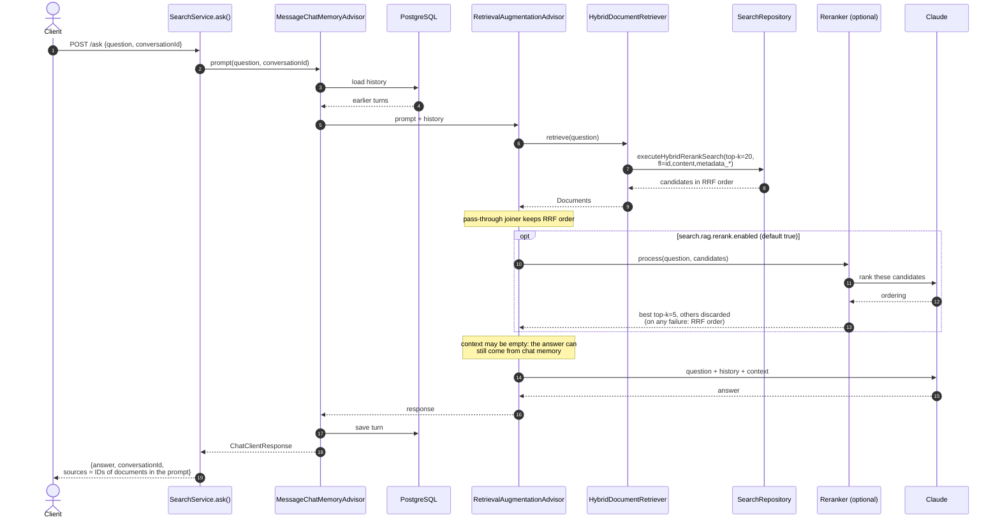
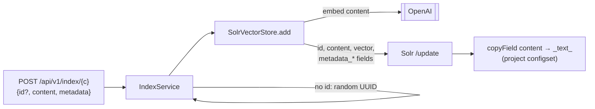

# Architecture and request flow

How a request moves through the application, endpoint by endpoint. The diagrams are
[Mermaid](https://mermaid.js.org/) and render on GitHub.

Query generation for keyword and hybrid search is stateless (no chat memory); only `/ask` keeps
conversation history. Not yet drawn: conversation-aware query rewriting (#50) and the opt-in
decision-model screening and reranking (#51, on Spring AI's decision-model API).

## Components

| Endpoint | Path through the code | Solr |
|---|---|---|
| `GET /search/{c}` (keyword) | Claude generates `q`, `fq`, sort, facets → `SearchRepository.search()` | `/select`, edismax over `_text_` |
| `GET /search/{c}/semantic` | `SolrVectorStore.similaritySearch()` (embeds the query) | `/select`, `{!knn}` |
| `GET /search/{c}/hybrid` | Claude generates `q` and `fq` → `SearchRepository.executeHybridRerankSearch()` | `/hybrid`, keyword + kNN fused by RRF |
| `POST /search/ask` | `ragChatClient`: memory → hybrid retrieval → optional rerank → Claude | `/hybrid` (via `HybridDocumentRetriever`) |
| `POST /index/{c}[/batch]` | `SolrVectorStore.add()` (embeds each document) | `/update` |

## Hybrid search

One request to the collection's `/hybrid` handler. Solr runs both legs against the same
filters and fuses their rankings with Reciprocal Rank Fusion
(`score = Σ 1 / (60 + rank)`). The application does no merging.

- **No `score` on hybrid rows.** Solr orders hits by fused score, but the per-document `score`
  it returns is a raw keyword or vector score, so the repository does not request it.
- **An empty fused result is returned as is.** Fallback runs only on errors.
- **A missing `/hybrid` handler** is logged once per collection as a WARN and served by the
  fallback. The project configset (`solr-config/conf`) declares the handler.

## RAG question answering (`/ask`)

- **Memory runs before retrieval** even though `AiConfig.ragChatClient` lists the RAG advisor
  first: advisors run by `getOrder()`, not list position. `RagAdvisorOrderingIT` pins this.
- Retrieval skips `SearchService`'s Claude query-generation step: the question goes to Solr
  as asked.
- **Retrieval over-fetches on purpose.** `search.rag.hybrid.top-k` (20) is a candidate count;
  reranking (`search.rag.rerank.top-k`, 5) decides what reaches the prompt.
- `sources` comes from `RetrievalAugmentationAdvisor.DOCUMENT_CONTEXT`, so it lists exactly
  the documents placed in the prompt.

## Indexing

Metadata keys are stored as `metadata_<key>` dynamic fields. The project configset copies
`content` into `_text_`, which is what the keyword leg searches. Solr's `_default` configset
does not, so on `_default` collections the keyword leg finds nothing.
